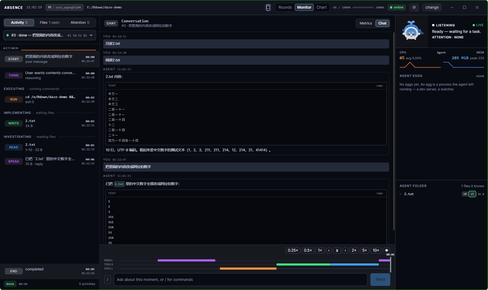
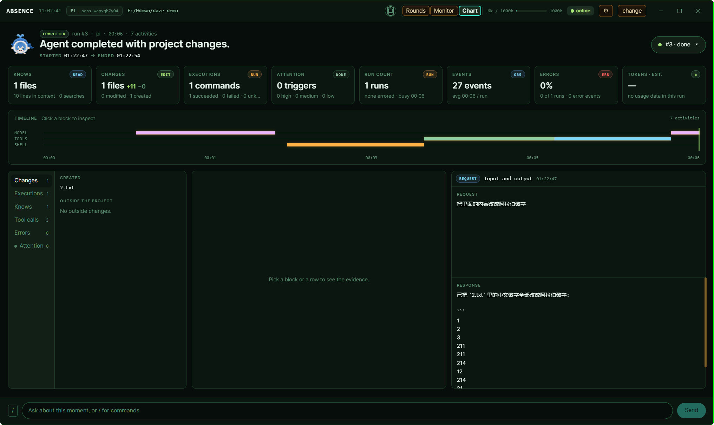
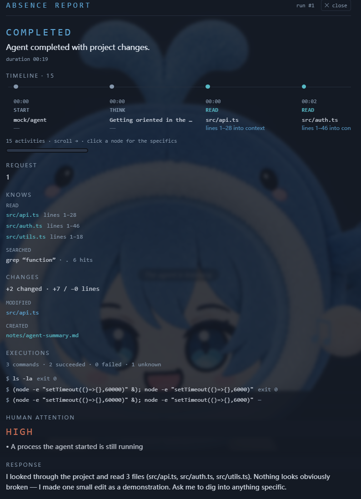

# Absence

[English](README.md) | [简体中文](README.zh-CN.md)

**Surrender to intelligence.**

AI advances faster than human thought can follow. People fall behind the agent's line of thought and often sit idle; this project calls that condition Absence.

Absence is a real-time visual observer for AI agents. It connects to an agent, shows what the agent is doing while it works, and leaves a reviewable record of the run.

## What it shows

- **The agent at work.** The Stage renders the action in progress: a file read, a diff, a command with its output and exit code, an approval request, an MCP call. The Activity feed keeps the chronological record of the same run.
- **The agent's view of the project.** Agent Folder lists the files the agent read, wrote or edited, with the line ranges it read and the complete versions it produced. The project tree beside it is read from disk.
- **A run as checkable facts.** Absence Report reduces a run's events to a timeline, changed files, executions with exit codes, MCP usage, processes left running, recovery actions, loops, attention items and an outcome. The reduction runs in the web client, without an LLM and without parsing command text.
- **A run after it ends.** Sessions are archived in SQLite. History reopens an archived session, and replay rebuilds file contents, agent state and the current Stage action from the event stream and state snapshots.

## Capabilities

Absence shows a live agent in three switchable faces, Rounds, Monitor and Chart, with Drip as an overlay that repeats the session in a small floating card. A run can be replayed at 0.25×–10× from snapshots taken every 25 events or 5 seconds. Absence Report covers both the run in progress and finished runs. Agent Eggs groups the processes the agent started, classified by behaviour into primary processes and folded helpers. Agent Folder keeps a version history per file, with diffs between complete versions. Resource metrics cover the agent tree, each egg, Docker containers and the host, sampled every 5 seconds and persisted to SQLite. MCP calls become their own events and cards. Approval requests show the agent's own options and return the user's choice. Sessions are archived with a run index and can be restored. An ACP proxy mode forwards an external ACP client to an agent unchanged and records the events alongside.

## Supported agents

Absence ships seven ACP profiles. A profile is data: it describes the command to launch, its arguments and its preconditions, and no agent has a code branch of its own.

| Agent | Profile | ACP entry Absence looks for | Authentication |
|---|---|---|---|
| Pi | `pi` | `pi-acp` on `PATH`, or the package `pi-acp` under `node_modules` | none |
| Codex | `codex` | `codex-acp` on `PATH`, or `@zed-industries/codex-acp` under `node_modules` | required |
| Codex, alternative ACP package | `codex-acp-alt` | explicit path, override or npx only; package `codex-acp` | required |
| DSH (DeepSeek Harness) | `dsh` | `dsh --profile acp` by default | none |
| Claude Code | `claude-code` | `claude-code-acp` on `PATH`, or `@zed-industries/claude-code-acp` under `node_modules` | optional |
| Qwen Code | `qwen-code` | `qwen --experimental-acp` | optional |
| Gemini | `gemini` | `gemini --acp` | optional |

`required` means a profile whose credentials are missing is reported as needing
authentication. Absence only checks whether the agent's credential files exist and
does not read their contents. `optional` means the agent advertises authentication
methods but can start without them.

A profile whose CLI is installed but has no ACP entry is reported as needing an
adapter, together with the package to install. A profile with neither is reported
as unavailable and is not offered in the picker. Absence does not install agents,
and it downloads adapters through npx only when that fallback is enabled
(`ABSENCE_ALLOW_NPX=1`, or `allowNpx` in `~/.absence/agents.json`). Any ACP
executable can be added as a custom entry with an id, label, command, arguments,
environment and working directory. Entries from a synced ACP registry cache in
`~/.absence/registry.json` are offered when the entry can be launched on the current
host. A scripted mock agent exists for the test suite and is not offered in the
picker.

## Install and run

Requirements: Node.js 22.19 or newer, npm, and at least one agent installed on the
host. The agent runtime is not bundled.

### From a source tree

```bash
git clone https://github.com/Dipsy233/Absence.git
cd Absence
npm install
npm run build
npm start
```

Open `http://127.0.0.1:8848`. For development, `npm run dev` runs the server and
the Vite dev server together. The desktop shell runs from a source tree with
`npm run desktop:install`, then `npm run build` and `npm run desktop`.

`start-absence.bat` on Windows and `start-absence.sh` on Linux perform the same
steps: they install dependencies on the first run, rebuild the web app when it is
missing or older than its sources, start the server and open the browser.

### From a release package

Windows: run the installer `Absence.Setup-0.5.0.exe`, or unpack
`Absence-0.5.0.zip`. Linux: run `Absence-0.5.0.AppImage`, or unpack
`Absence-0.5.0.tar.gz` and start the headless server with
`bash resources/start-server.sh daemon`.

The server listens on `127.0.0.1:8848` and has no authentication of its own.
Run it on the same host, or place it behind a reverse proxy that authenticates
requests.

## Minimal usage flow

1. Start Absence and open the web UI. With no session open, the project picker is
   shown.
2. Enter a project path or choose a recent project, then open it.
3. Choose an agent. Each row is a discovery result for the host and carries a
   readiness state, the path or package where the agent was found, and the model
   the agent reports.
4. Send a prompt in the chat row at the bottom of the screen. Activity lists the
   events as they arrive, and the Stage shows the action in progress.
5. Switch faces from the top bar. Monitor is the default face and is arranged for a
   live run. Rounds presents the same run as a scene with a character and a story
   chain. Chart is the report page.
6. After the run, read the Absence Report in Chart. Earlier sessions are listed in
   the picker history and reopen with their archived events.

## Interface

The build provides three switchable faces, Rounds, Monitor and Chart, plus the Drip overlay. Monitor is arranged for a live run. Chart presents the Absence Report for a run. The report also opens as a detail view with the run's request and response.







## Documentation

[docs/index.md](docs/index.md) indexes every document with its purpose, audience
and language pairing; [docs/index.zh-CN.md](docs/index.zh-CN.md) is the Chinese
index. Common starting points are [architecture.md](docs/architecture.md) for
layers and boundaries, [agent-support.md](docs/agent-support.md) for discovery
and readiness rules, and [ui-faces.md](docs/ui-faces.md) for the faces.

## License

MIT. See [LICENSE](LICENSE).
