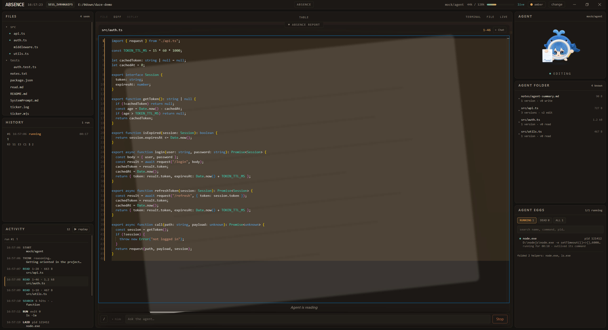
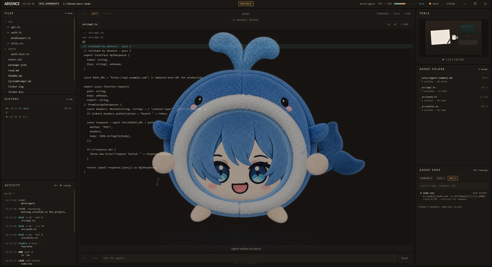

# Absence / 发呆症

> Surrender to intelligence!

> AI 正强到让人类渐渐跟不上它在做什么。我们把这种状态叫作 **Absence（发呆症）**。
>
> Absence 帮你看住 AI 的工作、弄清发生了什么，并最终坦然接受 AI 的统治。

Absence 是一个 AI agent 的实时可视化**观察器**。它不让 agent 变聪明——它让人
*看见* agent 在做什么。**Pi、Codex、Claude Code、Qwen Code、Gemini、DSH** 以及
任何会说 **ACP（Agent Client Protocol）** 的 agent，都经同一个标准接入层驱动。

```
agent 自己的终端软件运行 agent。
Absence 观察事件。
Stage 把事件变成人看得懂的东西。
```

- **实时观察**——一个可爱的 agent 化身：agent 的每次读、改、跑都以真实速度
  变成人看得见的动作。
- **回放**——每个 run 由事件+状态快照重建（不是视频），0.25×–10× 可拖。
- **Absence Report**——一个 run 几秒归约成事实：改了什么、跑了什么、败在哪、
  哪里需要你注意（包括 agent 撤销自己的修改、反复重试失败命令、留下的驻留
  进程）。无 LLM、不猜：只有观察器看到的。
- **Agent Eggs**——agent 拉起的每个进程，由内核事件捕获（Windows Job Object /
  Linux eBPF），按行为分类，不会被 `cat` 之类的帮手淹没真正的守护进程。
- **Agent Folder**——agent 视角的项目：只有它真读过的文件与行段，每个文件带
  版本历史。
- **资源指标**——agent 及其主进程的 CPU/RSS，实时曲线、会话均值、SQLite 持久化。

## 截图

**观察一个 run**——Stage、Activity 流、正在读项目的 agent：



**run 结束之后**——Absence Report、Agent Folder、Agent Eggs，化身回到 *listening*：



**Report 细节**——时间线、效果与证据链接：


## 快速开始

**源码运行**（需要 Node.js >= 22.19 与 npm，以及一个已安装并登录的 agent 运行时）：

```bash
git clone https://github.com/Dipsy233/Absence.git
cd Absence
npm install
npm run build
npm start
```

打开 `http://127.0.0.1:8848`，选择项目路径，在探测式选择器里挑一个 **可启动**
的 agent，点 **Open**，在底部输入框里给它派活。

**一键启动**（检出内，自动构建）：

```bat
start-absence.bat            :: Windows
./start-absence.sh           :: Linux
```

**下载运行**（从 Releases 取对应平台的包）：

```bat
:: Windows: 运行安装程序
Absence-Setup-0.5.0.exe
```

```sh
# Linux 桌面: AppImage 或 tar.gz
chmod +x Absence-0.5.0.AppImage && ./Absence-0.5.0.AppImage
# 或无头服务器: 只在 :8848 提供 UI
tar xzf Absence-0.5.0.tar.gz && cd Absence-0.5.0
bash resources/start-server.sh daemon
```

> Absence 不捆绑任何 agent 运行时：用你机器上已装的。选择器里没装适配器的行会
> 给出安装命令（Absence 不替你装）；不在列表里的 ACP agent 用 **"+"** 自定义入口
> 接入。细节见 [docs/AGENT_SUPPORT.md](docs/AGENT_SUPPORT.md)。

## 界面

- **左栏是你的视角**（整个项目、完整文件、从磁盘读）；**右栏是 agent 的视角**
  （只有它真读过的，绝不装作知道更多）。agent 读了 10–20 行，FILE 就只显示
  10–20 行；分两次读 1–2 和 3–5 就显示 1–5，中间没读的绝不悄悄补上，而是显式的
  `⋯` 标记。
- **Stage（中央）**——默认页是指标仪表盘；FILE / DIFF / TERMINAL / LIVE 以内容页
  打开；REPLAY 接管时带完整拖放控制。底部是聊天坞——一行输入、历史向上展开。
- **探测式选择器**——方格布局，每行是一次真实探测：状态（可启动/缺适配器/需
  登录）、发现来源、声明的模型、适配器安装提示；最后一格永远是 **"+"** 自定义
  ACP 入口。选中后，与该 agent 相关的事实（认证、模型来源、launch 覆盖）以
  **提示流**形式流入，而不是弹窗。
- **命令面板是补全器**——只列 agent 自己广告的 `/` 命令（`available_commands_
  update`）加 Absence 唯一的本地动作 `/auth`；回车把整行**原文**发给 agent。
- **Agent（右）**——鲸团团化身，姿态完全由事件流驱动：聆听、思考、说话、阅读、
  书写、执行、等待、出错。
- **Agent Eggs（右）**——`running` / `dead` / `all` 页签；按行为而非名字分类：
  活过命令的、自己拉子进程的、被命令点名的、被后台化/重定向的算 *primary*；
  短命帮手折叠成一个计数。
- **MCP 调用可见**——Activity 里显示 `MCP filesystem › list_directory`，Stage 上是
  终端卡片（参数、输出、text/json 切换）。

## Absence Report

由事件流推导（无 LLM、不解析命令）：run 进行中给出阶段与注意力等级；结束后给出
时间线、Knows（读过什么）、Changes（`+A/−D`）、Executions（退出码）、恢复动作与
结论。每条都是证据链接。注意力规则（失败连击、驻留蛋、文件版本回环、命令重试
回环、项目外改动）全部可在设置对话框里逐条配置阈值与等级。

## 个性化

`⚙ settings`：主题与栏序、头像皮肤（上传自己的 mp4/gif/png 动画替换鲸团团）、
提示音组、Agent Eggs 过滤档案。见 [docs/AVATAR_SKIN.md](docs/AVATAR_SKIN.md)。

## 配置

| 环境变量 | 默认 | 含义 |
|---|---|---|
| `PORT` / `HOST` | `8848` / `127.0.0.1` | 服务端口与监听地址 |
| `ABSENCE_AGENT` | `pi` | 默认 profile id；选择器按会话选择，此项只是兜底 |
| `ABSENCE_PROJECTS_ROOT` | `~/projects` | 项目选择器列出的目录 |
| `ABSENCE_STATE_DIR` | `~/.absence` | Absence 自己的状态目录（归档、agents.json、注册表缓存） |
| `ABSENCE_ALLOW_NPX` | 关 | 允许 npx 兜底下载适配器（也可用 agents.json 的 `allowNpx`） |
| `ABSENCE_*_BIN` | — | 各 profile 的 launch 覆盖（见 AGENT_SUPPORT） |
| `ABSENCE_MAX_EGGS` | `200` | 已结束蛋的保留上限；`0` 全保留 |
| `ABSENCE_METRICS_RETENTION_DAYS` | `30` | 进程指标保留天数；`0` 全保留 |
| `ABSENCE_SESSION_RETENTION_DAYS` / `ABSENCE_MAX_ARCHIVED_SESSIONS` | `0` / `0` | 会话归档保留策略，默认全保留 |
| `ABSENCE_DOCKER` / `ABSENCE_DOCKER_BIN` | 开 / 自动 | 容器观察 |
| `ABSENCE_AGENTWATCH` / `ABSENCE_AGENTWATCH_LINUX` | 仓库 `native/` | 内核观察器二进制路径 |
| `ABSENCE_LOG_LEVEL` | `info` | Fastify 日志级别 |

### 聊天命令

输入框里以 `/` 开头的行**原样转发给 agent**——Absence 不解析、不实现
`/model`、`/skill`、`/mcp` 或任何产品命令，认不认由 agent 决定。面板是补全器：
列 agent 广告的命令，加唯一的本地动作 `/auth <methodId>`（ACP `authenticate`）。
结果作为普通 run 事件返回并随会话归档。

### 运行时

runtime 是 **profile**（launch line + 环境 + 前置条件），不是代码分支。选中的
profile 起不来（没装、路径错）时 Absence **如实报错、绝不回退**到 mock。审批
询问以 `approval` 事件原样展示，用户的选择原样回传——Absence 从不替用户决定。

## 安全提示

Absence server **没有认证**，且 API 能列出并读取项目根下的文件。默认绑
`127.0.0.1`，桌面与单机安全；放到服务器上请留在可信网络或套一层带认证的反向
代理，不要把端口暴露到公网。

## 限制

- 历史**只来自 Absence 自己的归档**（SQLite，`~/.absence/absence.db`）；agent 的
  私有会话文件不读不合并。agent 侧上下文经归档里存的 ACP resume handle 恢复。
- ACP 的报告义务是 SHOULD 不是 MUST：`kind` 缺省、`locations` 只是显示元数据。
  "agent 看到的精确行段"在 agent 不报时标 `unknown`，Absence 不补。
- 进程归因靠 `kind=execute` 的生命周期窗口 + 命令行匹配：单条精确，多条并发且
  命令行对不上时可能归错（有兜底，不丢）。
- 会话存储用 `node:sqlite`（上游仍标记实验性），因此运行时固定（Electron
  `37.10.3`，Node 见 `.nvmrc`），SQLite 调用全部隔离在
  `apps/server/src/sessions/storage/db.ts`。
- 内核观察器无采样下限（20ms 进程也可见）；快照兜底有 ~0.5s 下限，孤儿进程
  不归因。Docker 容器走 daemon 事件流。
- 头像皮肤/提示音/egg 过滤器写在安装目录（`apps/server/src/process/`）下：
  打包成只读 asar 后上传会失败（既有行为，待迁到 `~/.absence/`）。

## 文档

- [docs/ARCHITECTURE.md](docs/ARCHITECTURE.md) —— 分层、只转发原则、只读配置
  策略、边界与保真度限制、API。
- [docs/AGENT_SUPPORT.md](docs/AGENT_SUPPORT.md) —— agent 发现顺序、状态机、
  适配器包、`ABSENCE_ALLOW_NPX`、自定义入口。
- [docs/TESTING.md](docs/TESTING.md) —— 验收检查与端到端仿真。
- [docs/TESTING-STRATEGY.md](docs/TESTING-STRATEGY.md) —— 为什么没有单测框架。
- [docs/decoupling.md](docs/decoupling.md) —— ACP-only 解耦的设计与判断标准；
  [docs/reference/r.txt](docs/reference/r.txt) 是它的原始分析。
- [docs/RELEASING.md](docs/RELEASING.md) —— 发布流程；[CHANGELOG.md](CHANGELOG.md)
  —— 各版本变更。
- [docs/UI_FACES.md](docs/UI_FACES.md) / [docs/NEW_UI.zh-CN.md](docs/NEW_UI.zh-CN.md)
  —— 界面面孔与新 UI 设计。

## License

[MIT](LICENSE)
