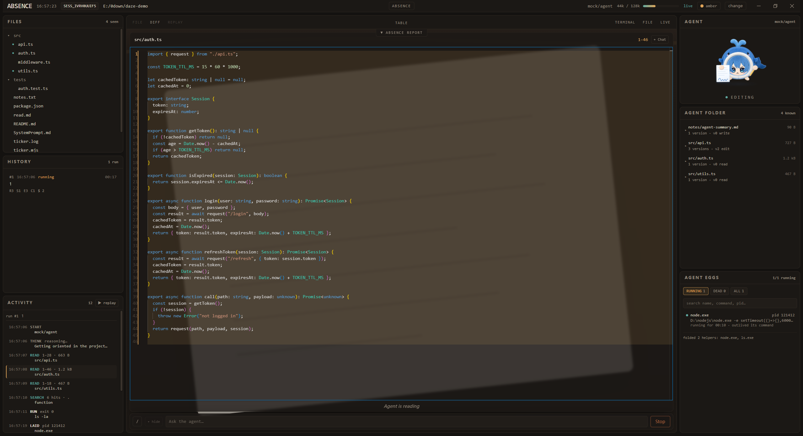
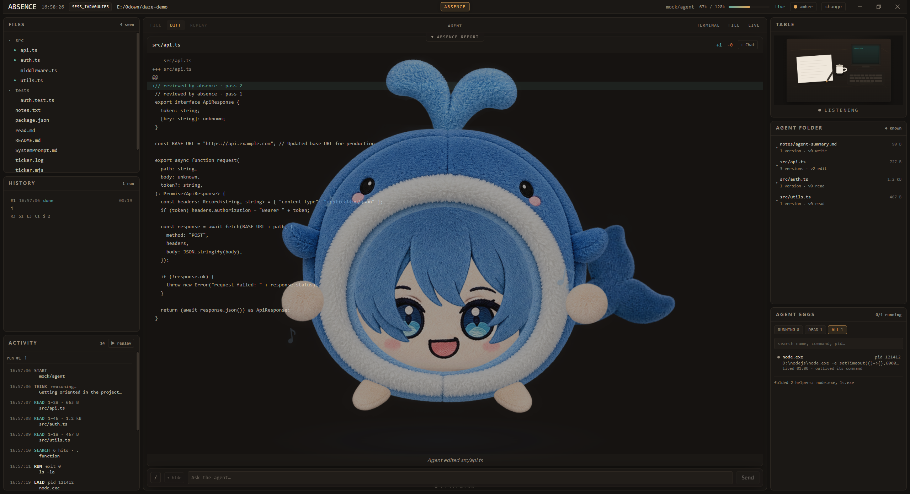
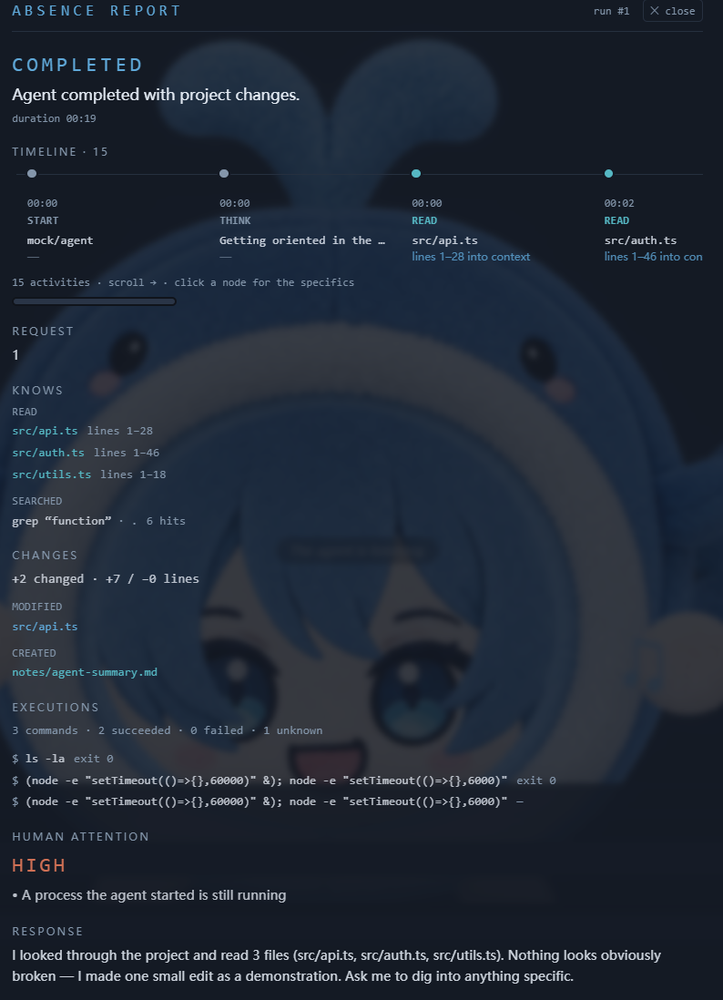

# Absence / 发呆症

[English](README.md) | 中文

> AI moves fast. Humans watch.

> AI 正变得无所不能，而人类正慢慢跟不上它做了什么。我们把这种状态称为
> **发呆症（Absence）**。
>
> Absence 帮你观察 AI 干活，理解发生的一切，最后臣服于 AI 的支配。

Absence 是一个面向 AI agent 的实时可视化观察器。它不试图让 agent 更聪明——
它让人*看见* agent 正在做什么。**Pi**、**OpenAI Codex** 和 **DSH**（DeepSeek Harness）都是一等运行时。

```
Pi、Codex 或 DSH 运行 agent。
Absence 观察事件。
Stage 把事件变成人可以看的东西。
```

- **实时观察** — 一张桌子、一台显示器、一张纸：agent 的每一次读、改、跑
  命令都变成人真正能看的东西，以真实速度实时播放。
- **Replay** — 每次运行都从事件 + 状态快照重建（绝不是录屏），可拖动进度条
  以 0.25×–10× 回放。
- **Absence Report** — 几秒钟内把一次运行归约成事实：改了什么、跑了什么、什么
  失败了、什么需要你——包括环路（agent 撤销自己的修改、反复重试失败的
  命令）和它留下的还在跑的进程。没有 LLM，不靠猜：只报告观察器亲眼看到的。
- **Agent Eggs** — agent 启动的每一个进程，由内核事件捕获（Windows 用
  Job Object，Linux 用 eBPF），按行为分类，所以 `cat` 之类的帮手永远不会
  淹没命令真正启动的那个守护进程。
- **Agent Folder** — agent 自己视角里的项目：只有它上下文里真正有的文件和
  行区间，每个文件带版本历史。

## 截图

**观察一次运行** — Stage、Activity 事件流，以及 agent 逐步读遍项目：



**运行结束之后** — Absence Report、Agent Folder、Agent Eggs，头像回到 *listening*：



**Absence Report 细节** — 时间线、效果与证据链接：



## 快速开始

环境要求：Node.js **22.19+**（测过 24）和 npm。需要一个运行时，Absence 用你**已安装的那个**：配置好的
**Pi**（`npm i -g @earendil-works/pi-coding-agent`，跑一次 `pi` 并登录）、已登录的 **Codex**（PATH 里有 `codex`），
或 **DSH**（DeepSeek Harness，如 DSH Desktop）。Absence 不内嵌任何一个——它是你装的那个运行时的客户端。
选中却启动不了时会**直接报错**，不会静默回退；另有一个脚本化的 **mock** 运行时，无需任何凭据就能试看。

```bash
npm install

npm run dev       # dev：web 在 :5173（代理 /api 和 /ws），server 在 :8848
npm run build     # 构建 web 应用
npm start         # 单源——server 在 :8848 上伺服构建好的应用
```

然后打开 `http://127.0.0.1:8848`，输入或选择项目路径，选运行时（**Pi**、**Codex** 或
**DSH**——绿点表示已找到），点 **Open**，在 Stage 底部的聊天框里给 agent 发任务。
运行时显示红点时，在紧下方的 **runtime paths** 面板里设置它的二进制/包路径（见
[Runtimes](#runtimes)）。路径框下面的 **History** 列表展开保存的会话——Absence 自己的
归档合并运行时的，最新在前；点一行重新打开那段对话。

### 一键启动器

```bat
start-absence.bat            :: Windows——构建、启动 server、打开 UI
start-absence.bat check      :: 干跑——报告会发生什么，什么都不启动
```

```sh
./start-absence.sh           # Linux——eBPF 观察器缺失时还会构建它
./start-absence.sh check     # 干跑
```

两者都是幂等的（已在监听的 server 不动），转发到 `scripts/browser/` 下的
真正启动器。用 `ABSENCE_PORT` 和 `ABSENCE_AGENT` 覆盖端口/运行时。

### 桌面应用（Electron）

```bash
npm run build             # 外壳伺服 dist/web
npm run desktop:install   # 一次——安装 Electron（自己的 node_modules）
npm run desktop           # 打开原生窗口
npm run desktop:dist      # 打包可分发版本（NSIS / AppImage + tar.gz / DMG）
npm run desktop:pack      # 同样，但输出未打包目录（更快）
```

桌面外壳在进程内运行 server——没有控制台窗口、`port: 0`、托盘图标、关到
托盘让观察继续跑，运行结束而窗口没聚焦时有原生通知。窗口和浏览器是同一个
web 应用；没有任何分叉。Windows 上 **`start-absence-app.bat`** 一键完成
构建 → 安装 → 打开。

### Linux 下载即用

Linux 版发布两个产物，都在 Linux 机器上构建（跑 `npm run desktop:dist`
——electron-builder 不支持从 Windows 交叉打包）：

- **`Absence-<version>.AppImage`**——单文件，`chmod +x` 后直接运行。宿主
  需要 libfuse2。
- **`Absence-<version>.tar.gz`**——解压到任意目录后运行 `absence`（在限制
  非特权用户命名空间的发行版上用 `./absence --no-sandbox`）。不需要 FUSE，
  适合服务器场景。

```sh
tar xzf Absence-0.3.0.tar.gz
./absence
```

两个产物都带 server bundle、构建好的 UI 和 eBPF 观察器 helper。内核观察器
另需 `cap_bpf,cap_perfmon`（见下面的服务器一节）；没有它观察器退回 `ps`
快照。

### 在服务器上运行（Linux）

同样的 `npm run build && npm start` 从一个源伺服整个 UI。要用内核级进程
观察器，先编译 eBPF helper，并以能加载它的权限运行 server：

```bash
bash native/agentwatch-linux/build.sh        # 需要 clang + 内核头文件
sudo ./start-absence.sh                          # root，或授予 capability：
sudo setcap cap_bpf,cap_perfmon+ep native/agentwatch-linux/agentwatch-linux
```

没有观察器时，watcher 退回 `ps` 快照，短命进程可能漏掉。

## 界面

```
┌──────────────────────────────────────────────────────────────┐
│                         SESSION BAR                          │
├──────────────┬───────────────────────────────┬───────────────┤
│    FILES     │  [FILE DIFF REPLAY]  TABLE    │     AGENT     │
│  (用户视角)  │      [TERMINAL FILE LIVE]     │   (头像)      │
│              │                               │               │
├──────────────┤───────────────────────────────┼───────────────┤
│   HISTORY    │                               │  AGENT FOLDER │
│   (运行)     │            STAGE              │  (agent 视角) │
├──────────────┤                               ├───────────────┤
│   ACTIVITY   │  replay 控件，仅在回放时出现  │  AGENT EGGS   │
│  (选中运行)  │  chat dock：只有一行输入      │ 它启动的进程   │
└──────────────┴───────────────────────────────┴───────────────┘
```

整个 UI 按"你在看谁的视角"切分——**左栏是你的**（整个项目、整个文件、从
磁盘读），**右栏是 agent 的**（只有它真正读过的部分，从不假装比它知道得
更多）。如果 agent 读过某文件的 10–20 行，它的 FILE 按钮只显示这些行——
读过 1–2 和 3–5 之后显示 1–5，中间从不会被悄悄接上；没读过的行变成显式的
`⋯` 标记。

- **Stage**（中）— 默认页是一张桌子；FILE / DIFF / TERMINAL / LIVE 视图以
  半透明叠层骑在上面，REPLAY 带完整的拖动控件（0.25×–10×）。Absence 按钮翻转
  图层：桌子以可点击穿透的 ghost 浮在内容*前面*。聊天停靠在底部——一行
  输入，历史向上展开，可收起。
- **Files → History → Activity**（左）— 项目树（`●` 标记 agent 碰过的文件，
  右键可检查/diff/历史）、每次运行一行的 History（带动作计数 `R` 读 ·
  `S` 搜索 · `E` 改 · `C` 建 · `$` 命令）、选中运行的动作——点一行放上
  Stage，或 **▶ replay** 从头回放。推理也被捕获：一条 `thinking` 事件是一行
  THINK，和它导致的动作并排。
- **Agent**（右）— WhaleBun 头像，姿势纯由事件流驱动：listening 放松、thinking
  思考、speaking 说话、reading 阅读、editing 书写、running 打字、waiting
  打盹、error 慌张。
- **Agent Folder**（右）— agent 的文件，最新在前，每个可展开成它持有过的
  版本（v0 读 → v1 写 → v2 改…）。文本在 agent 看到它的那一刻被捕获，所以
  磁盘上再发生什么都改写不了更早的版本。
- **Agent Eggs**（右）— agent 启动的进程，带 `running` / `dead` / `all`
  标签。按行为分类，不按名字：活得比命令久、自己生进程、被命令点名
  （`python train.py`）、被后台化/重定向、或从工作区运行的进程是 *primary*；
  短命帮手（`cat`、`grep`、`docker ps`）折成计数。所以 `docker compose up -d`
  显示的是容器而不是客户端；`nohup node ticker.mjs` 显示的是
  `node ticker.mjs` 而不是 `nohup`。可编辑的**过滤配置文件**（记录帮手命令名
  的命名文件）在设置弹窗右栏管理——侧栏 `+` 新建、content 编辑、`Apply` 保存
  并激活。
- **Session bar** — 会话 id、项目、模型、上下文用量、live/offline，以及一个
  `⚙ settings` 按钮，打开四栏设置弹窗：外观（配色、面板排序、聊天 collapse
  on content 开关）、Report（命令失败警告）、个性化（形象皮肤 + 音效集）、
  Agent Eggs 过滤配置文件。

## Absence Report

Stage 顶部中央的标签展开一份半透明报告，完全从事件流推导——没有 LLM，不
解析命令行：

- **运行进行中** — agent 现在在干什么：一个阶段（`investigating` /
  `implementing` / `executing` / `verifying` / `recovering`）、进度、和一个人工
  关注等级。
- **运行结束时** — 这次运行相当于什么：**Timeline**（每个活动一个节点，带
  它的效果——进了上下文的行、`+A / −D`、退出状态）、**Knows**（读了哪些
  文件、跑了哪些搜索）、**Changes**（新建/修改/删除，带 `+A / −D`）、
  **Executions**（命令与退出状态）、恢复、结局、和 agent 的回复。每一项都是
  证据链接——点它在报告旁边打开内容，并高亮 Activity 里的对应行。

人工关注盯着 agent 自我挫败：**文件版本环路**（新版本与更早版本逐字节相同
——一次被撤销的修改）和**命令重试环路**（同一条命令失败两次以上）把关注
抬到 *medium*；**连续失败串**（命令一条接一条地失败，中间没有任何成功，
默认 ≥3 条）触发 `command_failure_streak`；**项目外改动**到 *low*；运行结束后
**还在跑的蛋**到 *high*。**命令失败警告**默认在单次运行里失败命令达到 **5 条**
时才提升关注等级，触发阈值和警告等级（none / low / medium / high）都可在设置
弹窗的 REPORT WARN 栏自定义，连续失败串与 **activity time** 告警（agent 在一个
动作上停留超过默认 **3600 秒**无任何事件，触发 `activity_stalled`）的阈值与
等级同样可配；未恢复的失败
始终是 *high*，不受阈值影响。实时关注等级跨入/跨出 medium/high 时有一声关注
铃，运行结束有完成铃。

## 个性化

顶栏的 `⚙ settings` 按钮打开一个四栏设置弹窗：

- **外观（左）**——配色主题（`amber` / `blue` / `green`）、左右两栏面板的堆叠
  顺序，以及聊天 **collapse on content** 开关（默认关：对话在所有页面之间保持
  不动；开启：file / diff / terminal / report 页面会把它收起）。
- **Report（左二）**——Absence Report 的**命令失败警告**（command failed per
  run：默认 ≥5 条时提醒，等级 `low`）、**连续失败串警告**（failure streak：
  默认连续失败 ≥3 条时提醒，等级 `medium`）和 **activity time 告警**（agent
  停留超过默认 3600 秒无任何事件时提醒，等级 `medium`）；阈值与等级均可调，
  `silent` 可完全关掉对应提醒。
- **个性化（中，形象皮肤 + 音效集同栏堆叠）**——
  - **形象皮肤**——不上传代码、不写 URL，直接用自己的动画替换内置的
  WhaleBun 角色：创建一个形象（名称 = `apps/server/src/process/avatar-skins/`
  下的一个文件夹），选一个状态（`default` / `listening` / `thinking` / … /
  `error`），上传 mp4 / gif / png / webp / svg 文件，它就成为该状态的动画。
  没上传文件的状态回退到该形象的 `default`；仍缺的显示内置角色。上传的视频
  会用 ffmpeg 自动转码（H.264、faststart、去除数据轨道），保证浏览器一定能
  播。`Apply` 启用该形象；切回 WhaleBun 恢复内置角色。更新实时生效，无需刷新。
  - **音效集**——按事件（`attention` / `complete` / `approval`）上传音频来替换
  合成铃；没上传文件的事件保留内置音调。`Apply` 启用该音效集；`Default`
  恢复合成铃。
- **Agent Eggs 过滤配置文件（右）**——一个小型配置文件管理器，布局与形象皮肤
  一致：左侧 **saved** 列表列出已保存的 profile（`●` 标记当前激活的，高亮的是
  正在编辑的），侧栏底部的 **new name + `+`** 新建一个空 profile 并载入编辑器
  （不改变激活项）；右侧 `editing:` 显示正在编辑的 profile，下方整个 content
  文本域一行一个帮手命令名。**Apply** 保存当前编辑的 profile 并激活（同名
  覆盖）；分类器把名单里的名字当作工具，**force** 选项可扩展到命令的声明主体
  （例如 `node ticker.mjs` 里的 `node`）。**display in activity** 开关（默认关）
  会从 Activity 面板隐藏 LAID/DIED 进程行，同时 Agent Eggs 面板仍保留这些蛋。

详见 [docs/AVATAR_SKIN.zh-CN.md](docs/AVATAR_SKIN.zh-CN.md)
（[英文版](docs/AVATAR_SKIN.md)）。

## 配置

| 环境变量 | 默认 | 含义 |
|---|---|---|
| `PORT` | `8848` | Server 端口 |
| `HOST` | `127.0.0.1` | Server 主机 |
| `ABSENCE_AGENT` | `pi` | 默认运行时：`pi`、`codex`、`dsh` 或 `mock`。项目选择器可按会话选；这是回退值 |
| `ABSENCE_PROJECTS_ROOT` | `~/projects` | 项目选择器列出的目录 |
| `ABSENCE_PI_BIN` | （探测） | Pi coding-agent 包目录或其 `dist/index.js`。不设置：先用全局安装，再用 Absence 旁的副本。可在选择器里设置，持久化到 `~/.absence/runtimes.json` |
| `ABSENCE_PI_TOOLS` | `read,bash,edit,write,grep,find,ls` | 启用的 Pi 内建工具。`bash` / `powershell` 由 Absence 自己的 shell 提供，这正是进程可被观察的原因 |
| `ABSENCE_CODEX_SANDBOX` | `workspace-write` | Codex 沙箱：`read-only`、`workspace-write` 或 `danger-full-access`。不设置时 app-server 默认只读，每次写入都会卡在审批上 |
| `ABSENCE_CODEX_APPROVAL` | `on-request` | Codex 审批策略：`untrusted`、`on-request`、`on-failure` 或 `never` |
| `ABSENCE_CODEX_APPROVAL_DECISION` | `ask` | Absence 如何处理 Codex 的审批提示：`ask`（记为一条 activity 并等用户点选），或自动 `accept` / `accept-for-session` / `decline` |
| `ABSENCE_CODEX_EXEC_SERVER` | 开 | 通过 Codex 的 exec-server 协议接管其 shell（见下）。设为 `0` 则让 Codex 自己跑命令，仅依赖 Job Object 观察器 |
| `ABSENCE_CODEX_BIN` | （PATH） | Codex 入口：`codex.js` 或 `codex` 可执行文件。不设置：用 PATH 里的 `codex`。可在选择器里设置，持久化到 `~/.absence/runtimes.json` |
| `ABSENCE_DSH_BIN` | （探测） | dsh 入口（`.../dsh/lib/bin.js`）。不设置：探测 DSH Desktop 安装目录，再用 PATH 里的 `dsh`。可在选择器里设置 |
| `ABSENCE_DSH_PROFILE` | `acp` | dsh 启动的 profile（`dsh --profile acp`） |
| `ABSENCE_DSH_HOME` | `~/.dsh` | 给 spawn 的 dsh 进程的 `DSH_HOME` |
| `ABSENCE_DSH_PROVIDER` / `ABSENCE_DSH_MODEL` | （profile 默认） | ACP 会话启动时的 provider / model |
| `ABSENCE_LOG_LEVEL` | `info` | Fastify 日志级别 |
| `ABSENCE_STATE_DIR` | `~/.absence` | Absence 归档会话历史的位置 |
| `ABSENCE_AGENTWATCH` / `ABSENCE_AGENTWATCH_LINUX` | 仓库 `native/` | 覆盖原生观察器二进制路径 |

### 聊天命令

chat dock 兼作小终端：以 `/` 开头的行是命令，其他都是 prompt。`/model`、
`/thinking`、`/permission`、`/compact`、`/name`、`/session`、`/export [html|jsonl]`。
`/permission` 设置 agent 运行的沙箱（`read-only`、`workspace-write`、
`danger-full-access`）。切换模型是会话级的；结果随会话归档，恢复时会回来。命令经
运行时无关的适配器分发，所以在 Pi、Codex 和 DSH 上行为一致。

### 运行时

Absence 驱动三个 agent 运行时；项目选择器（和 `ABSENCE_AGENT`）决定用哪个。它是
*客户端*：调用你装的运行时，不内嵌任何一个，所以选择器会显示每个运行时的位置，
探测不到时还能手动设置路径。

- **Pi** — 是库不是 CLI：Absence 在进程内加载 `@earendil-works/pi-coding-agent`
  SDK（`PiAdapter`），有全局安装就用全局的，并包住 Pi 自己的 shell 操作
  （`AbsenceShell`），从而拥有命令边界。可在选择器里设置包路径或用
  `ABSENCE_PI_BIN`。
- **Codex** — Absence 驱动 `codex app-server`，这是 Codex 为观察者定义的
  JSON-RPC 通道（`CodexAdapter`）。不同于 `codex exec --json`，app-server 带有
  真实的 item id、call id 和时间戳，所以命令的生命周期能与它拉起的进程精确配对。
  Absence 随后**接管 Codex 的 shell**，在那里也拥有命令边界。用的 `codex` 是
  PATH 里的（或你设置的路径）；Absence 不自带。
- **DSH**（DeepSeek Harness）— Absence spawn `dsh --profile acp`，即 DSH 自带的
  自动化专用 Agent Client Protocol server（`DshAdapter`）：JSON-RPC over stdio，
  stdout 完全属于 ACP。它的 `session/update` 通知变成 AbsenceEvent，每个 shell
  工具调用打开一个进程窗口，让 Agent Eggs 看到 agent 拉起了什么。

当选中的运行时启动不了（未安装或路径不对），Absence **报错且不回退**——选择器
显示错误，让你去修运行时，而不是不知情地跑别的。**mock** 运行时始终可用，会为
观察器拉起真实进程。

无论哪种，Absence 其余部分只看得到 `AbsenceEvent`；Stage、Replay、Report 和
聊天命令从不需要知道是哪个运行时在跑。

当运行时请求提权时（Codex，或 DSH 的 ACP permission 请求），Absence 会发一个
`approval` 事件：Activity 记一行 `APPROVE?`，agent 停在那里等你的决定。和其他
activity 一样，点这一行才会
在 Stage 打开原文和可选项——不会有任何东西被强制推到 Stage 上。

### 接管 Codex 的 shell

Pi 的 shell 就是 Absence 自己的（见 `AbsenceShell`），这正是 Absence 能看到
Pi 每条命令所拉起的所有进程的原因。Codex 跑在独立进程里，同样的办法用不上
——但 Codex 暴露了一个 **exec-server**：它会把命令执行委托过去。Absence 起一个
loopback exec-server，用 `environment/add` 注册它，并把 thread 固定到该
environment，于是 Codex 会把每条命令作为 `process/start` 交给 Absence，由
Absence 自己 spawn。

这一点很关键：Codex 自己 spawn 的命令可能逃出观察器所在的 Job Object
——`Start-Process` 等分离式启动会经 shell（explorer.exe）委派，而它不在 job 里，
进程就此消失。由 Absence spawn 时，命令始终是 Absence 的子进程、在 job 内，退出也
是第一手观测到的，所以蛋永远不会卡在 `running`。设
`ABSENCE_CODEX_EXEC_SERVER=0` 可关闭此机制，仅依赖观察器。

这一接管也是 Codex 在 Linux 上可被观察的前提。Linux 侧的观察器是 eBPF（见
`native/agentwatch-linux`），它不上报任何环境标记，进程只能靠祖先链归因；Windows
专用的 `ABSENCE_SESSION_ID` 在这里无处附着。由 Absence spawn 后，祖先链天然完整，
于是两个平台上每个蛋都能落到拉起它的那条命令上。

executor 也负责中断。当命令不以 PTY 运行时，Codex 不会向 stdin 写 Ctrl+C 来停止
它，而是调 `process.interrupt()`，以 `process/signal { signal: "interrupt" }` 到达。
Absence 用一个进程树 kill 来响应——这就是真实控制台里 Ctrl+C 对命令的含义。
（一个忽略 `process/signal` 的 executor 会让命令继续运行，agent 就会报告
「Ctrl+C 无效」。）

命令的运行方式与 Codex 自己的 executor 一致。Codex 默认用普通管道，只在模型要求
`tty: true` 时才分配 PTY；Absence 也是如此——`tty: true` 时用 `node-pty`（Windows
上为 ConPTY）开真 PTY，否则用普通管道。PTY 会把 stdout 与 stderr 合并为单一流
（以 `pty` 上报），并转发写入其中的 Ctrl+C，因此交互式命令的行为与原生完全一致。

命令运行的环境也与 Codex 自己的 executor 完全一致。Codex 会同时发一个 `env_policy`
（inherit / exclude / set / include-only）和一个稀疏的 `env`；Absence 严格按
Codex 的 `shell_environment::create_env` 规则将该策略作用于自身环境
（`ShellEnvironment.ts`），再让请求的 `env` 覆盖。从策略而非裸 `env` 构建环境，
正是 `PATH` 与 `PATHEXT` 得以保留的原因，因此 `node ticker.mjs` 能像原生一样找到
`node`。

## 安全提示

Absence server **没有鉴权**，其 API 可以列出目录并读取配置的项目根下的文件。
它默认绑定 `127.0.0.1`，对桌面应用和个人机器是安全的。如果你在 Linux
服务器上运行并从网络访问，请保持在可信网络内，或放在有鉴权的反向代理后面
——不要把端口暴露到公网。

## 注记与限制

- 会话**持久化到磁盘**，重启后还在。Pi 把模型的对话放在
  `~/.pi/agent/sessions/`；Absence 把 `AbsenceEvent` 流放在 `~/.absence/sessions/`
  （用 `ABSENCE_STATE_DIR` 覆盖）。选择器的 **History** 两种都能重开。Codex 会话
  通过 `thread/resume` 恢复（Absence 保存 thread id）。历史保存在各平台的
  家目录下；把 `ABSENCE_STATE_DIR` 指到同一个共享路径可以合并——但绝不要
  两边同时对同一个文件跑。
- Pi **没有删除工具**——删除必须走 `bash rm`。当 agent 改为写入空内容时，
  文件是*被截断，不是被删除*，Absence 会标 **EMPTIED** 加字节数，让假删除一眼
  可见。
- 有内核观察器（Job Object / eBPF）时没有采样下限——20 ms 的进程和任何
  进程一样被看见。快照回退有 ~0.5 秒的下限，从命令孤立的进程
  （命令返回后的 `npm run dev &`）不会被归属，agent *绕过* shell 启动的
  进程（WMI、计划任务、别的 pid namespace）暂时看不见。在原生 Linux 内核上，
  eBPF 观察器上报的 pid 与 `/proc` 视图一致。
- 桌子世界的 `DeskState` / `DeskItem` 存在但尚未被事件驱动。

## 文档

- [docs/ARCHITECTURE.zh-CN.md](docs/ARCHITECTURE.zh-CN.md) — 事件管道、进程
  观察与分类、仓库目录树、`AbsenceEvent` schema、HTTP/WS API、聊天命令、桌面
  打包内部机制。
- [docs/TESTING.zh-CN.md](docs/TESTING.zh-CN.md) — 验收检查脚本及各自钉住的
  规则。
- [docs/RELEASE_NOTES_v0.3.0.md](docs/RELEASE_NOTES_v0.3.0.md) — v0.3.0 带来了
  什么：Codex 支持、shell 接管、PTY、审批即 activity；以及 v0.3.0 之后的变更
  （DSH 运行时、可配置报告警告、音效集、检查 harness 重构）。
- [docs/RELEASE_NOTES_v0.2.0.md](docs/RELEASE_NOTES_v0.2.0.md) — v0.2.0 带来了
  什么：形象皮肤、Eggs 过滤配置文件、设置弹窗。

## 许可

[MIT](LICENSE)
