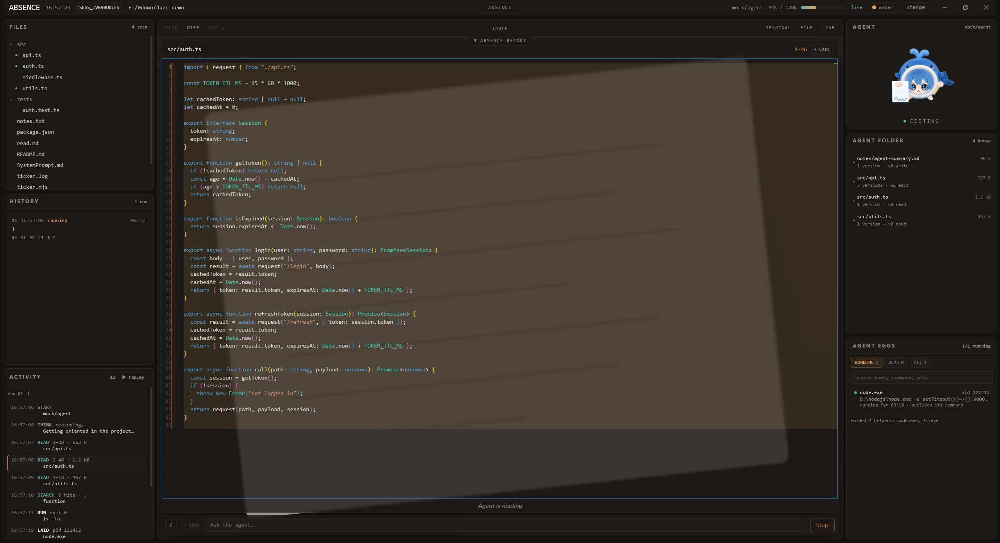
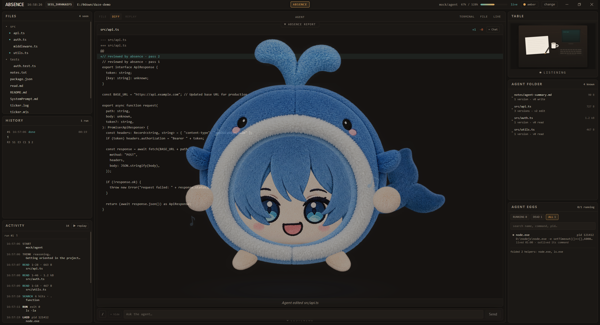
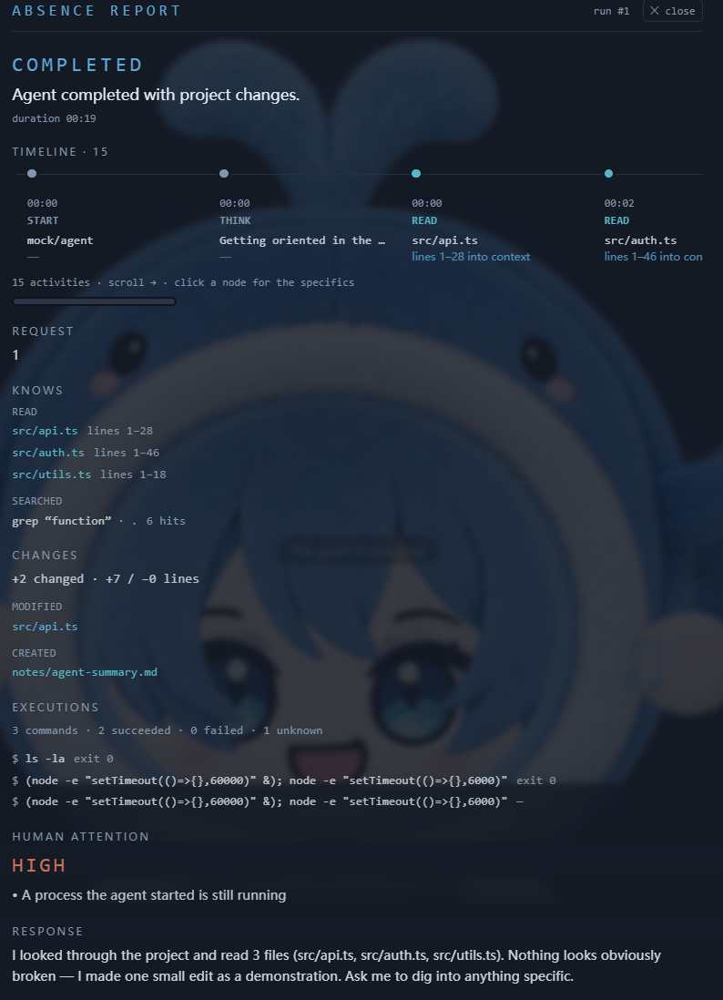

# Absence（发呆症）

[English](README.md) | [简体中文](README.zh-CN.md)

Absence 是 agent 行为观察器与 ACP 客户端。它启动一个使用 Agent Client Protocol
（ACP）的 agent，并在 agent 工作期间展示它做了什么。

Absence 启动已配置的 agent profile 并通过 ACP 驱动它：发送提示词、把 agent 的
审批请求交给用户、执行 ACP 认证调用。

ACP 消息与 OS 事实被投影为同一类事件 `AbsenceEvent`：agent 消息与思考、工具调用
及其映射出的文件、diff、命令、搜索或 MCP 内容、进程创建与退出、文件变化。界面、
归档、回放与 Absence Report 都读取这一事件流。

## 解决的问题

- **看见 agent 在做什么。** Stage 呈现当前动作：文件读取、diff、带输出与退出码的
  命令、审批请求、MCP 调用。Activity 流保留同一次 run 的时间顺序记录。
- **区分 agent 的视角与项目本身。** Agent Folder 列出 agent 读过、写过、编辑过的
  文件，包括它读过的行段和它产生的完整版本；旁边的项目树从磁盘读取。
- **把一次 run 变成可核对的事实。** Absence Report 把 run 事件归约为时间线、文件
  变化、带退出码的命令执行、MCP 使用、遗留进程、恢复动作、循环、注意力项与结论。
  归约在 Web 端完成，不调用 LLM，也不解析命令文本。
- **在 run 结束后回看。** 会话归档在 SQLite 中；History 重新打开已归档的会话，回放
  依据事件流与状态快照重建文件内容、agent 状态与 Stage 当前动作。

## 核心能力

Absence 以三个可切换的 face（Rounds、Monitor、Chart）展示正在运行的 agent，Drip
是叠加在当前 face 上的浮层，用一张小卡片重复当前会话。一次 run 可以 0.25×–10×
回放，快照每 25 个事件或 5 秒生成一次。Absence Report 同时覆盖进行中的 run 与已
结束的 run。Agent Eggs 汇总 agent 启动的进程，按行为分为 primary 进程与被折叠的
助手进程。Agent Folder 为每个文件保留版本历史，并支持完整版本之间的 diff。资源
指标覆盖 agent 进程树、每个 egg、Docker 容器与主机，每 5 秒采样一次并持久化到
SQLite。MCP 调用生成独立事件与卡片。审批请求按 agent 提供的选项展示，并原样回传
用户的选择。会话带 run 索引归档，可以恢复。ACP 代理模式把外部 ACP 客户端原样
转发到 agent，旁路记录事件。

## 支持的 agent

Absence 内置 7 条 ACP profile。profile 是数据：它描述启动命令、参数与前置条件，
每个 agent 没有自己的代码分支。

| Agent | profile | Absence 查找的 ACP 入口 | 认证 |
|---|---|---|---|
| Pi | `pi` | `PATH` 上的 `pi-acp`，或本地包 `pi-acp` | 无 |
| Codex | `codex` | `PATH` 上的 `codex-acp`，或 `@zed-industries/codex-acp` | 必需 |
| Codex（替代 ACP 包） | `codex-acp-alt` | 仅显式路径、覆盖或 npx；包 `codex-acp` | 必需 |
| DSH（DeepSeek Harness） | `dsh` | 默认 `dsh --profile acp` | 无 |
| Claude Code | `claude-code` | `PATH` 上的 `claude-code-acp`，或 `@zed-industries/claude-code-acp` | 可选 |
| Qwen Code | `qwen-code` | `qwen --experimental-acp` | 可选 |
| Gemini | `gemini` | `gemini --acp` | 可选 |

“必需”表示凭据缺失时，profile 被报告为需要认证；Absence 只检查该 agent 的凭据
文件是否存在，不读取文件内容。“可选”表示 agent 会广告认证方式，但没有凭据也可以
启动。

CLI 已安装但没有 ACP 入口的 profile 被报告为缺少适配器，并给出需要安装的包；两者
都没有的 profile 报告为不可用，不出现在选择器中。Absence 不安装 agent，也只在
npx 兜底被显式启用时才下载适配器（`ABSENCE_ALLOW_NPX=1`，或
`~/.absence/agents.json` 中的 `allowNpx`）。任意 ACP 可执行文件都可以作为自定义
条目接入，条目包含 id、label、command、args、env 与 cwd。已同步的 ACP registry
缓存（`~/.absence/registry.json`）中的条目在本机可以启动时出现在选择器中。测试
使用的脚本化 mock agent 不出现在选择器中。

## 安装与启动

要求：Node.js 22.19 或更高版本、npm，以及本机至少安装一个 agent。Absence 不捆绑
agent 运行时。

### 从仓库运行

```bash
git clone https://github.com/Dipsy233/Absence.git
cd Absence
npm install
npm run build
npm start
```

打开 `http://127.0.0.1:8848`。开发时 `npm run dev` 同时启动服务端与 Vite 开发
服务器。桌面壳在检出中的启动顺序为 `npm run desktop:install`、`npm run build`、
`npm run desktop`。

Windows 的 `start-absence.bat` 与 Linux 的 `start-absence.sh` 执行同样的步骤：首次
运行时安装依赖，Web 构建缺失或比源码旧时重新构建，启动服务端并打开浏览器。

### 从安装包运行

Windows：运行安装程序 `Absence.Setup-0.5.0.exe`，或解压 `Absence-0.5.0.zip`。
Linux：运行 `Absence-0.5.0.AppImage`，或解压 `Absence-0.5.0.tar.gz` 后以
`bash resources/start-server.sh daemon` 启动无界面服务端。

服务端监听 `127.0.0.1:8848`，自身没有认证。请在本机使用，或放在带认证的反向代理
之后。

## 最小使用流程

1. 启动 Absence 并打开 Web 界面。没有会话时显示项目选择器。
2. 输入项目路径或选择最近项目，然后打开。
3. 选择一个 agent。每一行是本机的探测结果，带有就绪状态、发现路径或包，以及 agent
   报告的模型。
4. 在屏幕底部的聊天行发送提示词。Activity 按时间列出事件，Stage 显示当前动作。
5. 在顶栏切换 face。Monitor 是默认 face，按实时 run 组织；Rounds 把同一次 run 呈现
   为带角色与故事链的场景；Chart 是报告页。
6. run 结束后在 Chart 中查看 Absence Report。更早的会话列在选择器历史中，打开时
   带回已归档的事件。

## 界面

当前版本有三个可切换的 face：Rounds、Monitor、Chart，另有 Drip 浮层。下面的截图
拍摄于 Classic 布局被移除之前，作为当时界面的记录保留；
[ui-faces.zh-CN.md](docs/ui-faces.zh-CN.md) 描述当前的 face。







## 文档

[docs/README.zh-CN.md](docs/README.zh-CN.md) 是文档索引，列出每份文档的用途、读者
与语言配对；[docs/README.md](docs/README.md) 是英文索引。常用入口：
[architecture.zh-CN.md](docs/architecture.zh-CN.md) 说明分层与边界，
[agent-support.zh-CN.md](docs/agent-support.zh-CN.md) 说明发现与就绪规则，
[ui-faces.zh-CN.md](docs/ui-faces.zh-CN.md) 说明当前的 face。

## 许可证

MIT，见 [LICENSE](LICENSE)。
